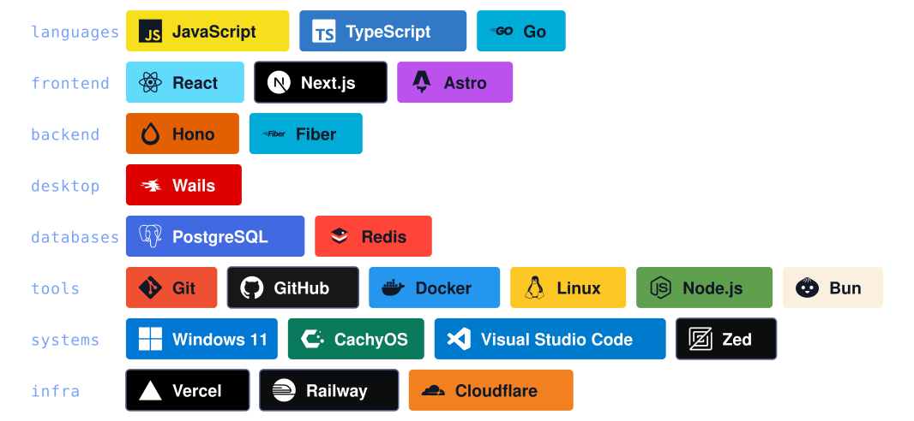
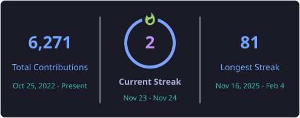
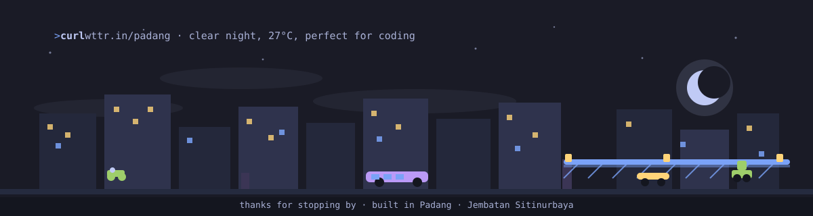

  <picture>
    <source media="(prefers-color-scheme: dark)" srcset="./assets/readme/hero.svg" />
    <source media="(prefers-color-scheme: light)" srcset="./assets/readme/hero-light.svg" />
    
  </picture>

  
  
  
  
  
  
  
  

---

### About

I'm **Drenzzz**, a software engineering student at Politeknik Negeri Padang, building practical tools with Go, TypeScript, and JavaScript. Fullstack web apps and REST APIs with Next.js, Go, and modern backend tooling. Desktop GUIs that feel native with Wails plus React and TypeScript. Systems work in Linux tooling, Android ROM workflows, and virtualization experiments. Personal, open-source, and university projects. Linux first when it matters.

---

### Stack

  

---

### Featured work

| Project                                                                       | What it does                                                                      | Stack                                         |
| ----------------------------------------------------------------------------- | --------------------------------------------------------------------------------- | --------------------------------------------- |
| [**ADBKit**](https://github.com/Drenzzz/ADBKit)                               | Cross-platform desktop client for Android device management (ADB and Fastboot)    | Go, Wails, React, TypeScript                  |
| [**Mitra Wiradoor Sumbar**](https://github.com/Drenzzz/mitra-wiradoor-sumbar) | Company profile and e-catalog: storefront, CMS, inquiry, guest checkout, and RBAC | Next.js, React, TypeScript, PostgreSQL        |
| [**Hayainime API**](https://github.com/Drenzzz/Hayainime-API)                 | REST API for anime data: search, schedules, details, and streaming, with caching  | Go, Fiber, Colly, Redis                       |
| [**Techyst**](https://github.com/Ambanet-Corporation/techyst)                 | AI-assisted hardware diagnostic app for smartphone repair technicians             | Next.js, React, TypeScript                    |
| [**FoodQCheck**](https://github.com/Drenzzz/umkm-food-quality)                | Capstone: food-quality classification with a model, API backend, and mobile app   | Python, FastAPI, TensorFlow, React, Capacitor |

---

### Activity

<!-- Copy-paste in your Readme.md file -->

<a href="https://next.ossinsight.io/widgets/official/compose-user-dashboard-stats?user_id=116653610" target="_blank" style="display: block" align="center">
  <picture>
    <source media="(prefers-color-scheme: dark)" srcset="https://next.ossinsight.io/widgets/official/compose-user-dashboard-stats/thumbnail.png?user_id=116653610&image_size=auto&color_scheme=dark" width="771" height="auto">
    
  </picture>
</a>

<!-- Made with [OSS Insight](https://ossinsight.io/) -->

 

  

 

  

  <picture>
    <source media="(prefers-color-scheme: dark)" srcset="https://raw.githubusercontent.com/Drenzzz/Drenzzz/output/github-snake-dark.svg" />
    <source media="(prefers-color-scheme: light)" srcset="https://raw.githubusercontent.com/Drenzzz/Drenzzz/output/github-snake.svg" />
    
  </picture>

---

  

